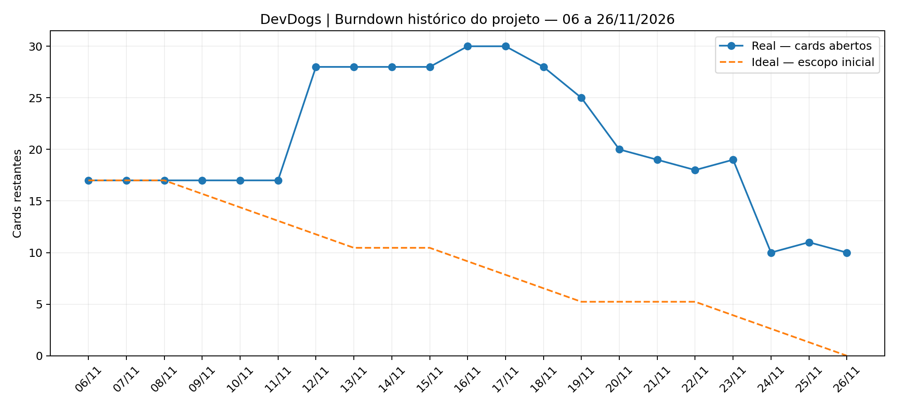

# Burndown — Sprint 03 | DevDogs

Período: 06/11 a 26/11/2026. 14 dias úteis, incluindo a data inicial; 20/11 é feriado.

## Histórico de cards

Fonte: chart.csv (GitHub Insights). A série Open representa cards restantes; Completed é o acumulado exportado no intervalo. O saldo passou de 17 para 10; o acumulado concluído chegou a 24 e o escopo observado aumentou de 17 para 34 (+17 líquidos). O histórico não está comprovadamente filtrado por milestone. A linha ideal usa 06/11 como ponto inicial e 13 dias úteis subsequentes.

## Balanço por Story Points

Fonte: exportação TSV da Sprint 03 e consulta somente leitura ao [repositório](https://github.com/DevDogs-2026/ABP-Portal-Certificacao-Ageis). Pontuação por área conforme critérios acordados; PRs e #156 não pontuados.

| Indicador | SP |
|---|---:|
| Concluídos no TSV | 115 |
| Pendentes no TSV | 46 |
| Total confirmado no TSV | 161 |
| Conclusão ponderada no TSV | 71.4% |
| Pontos adicionais sem status confirmado | 25 |

## Limitações

A consulta por milestone retornou cinco issues adicionais (#136, #146, #148, #150, #152) ausentes no TSV. Não foram classificadas como concluídas ou pendentes. As datas de fechamento e de movimentação não foram recuperadas; portanto não é possível determinar a curva diária real em SP, o escopo inicial em SP ou a velocidade definitiva. O relato de conclusão de #154 em 19/11 não comprova a data de transição para Done. A planilha contém a matriz de issues e fontes.